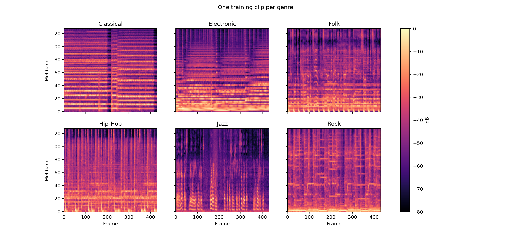
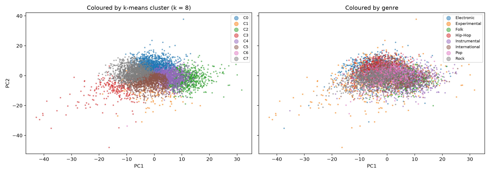
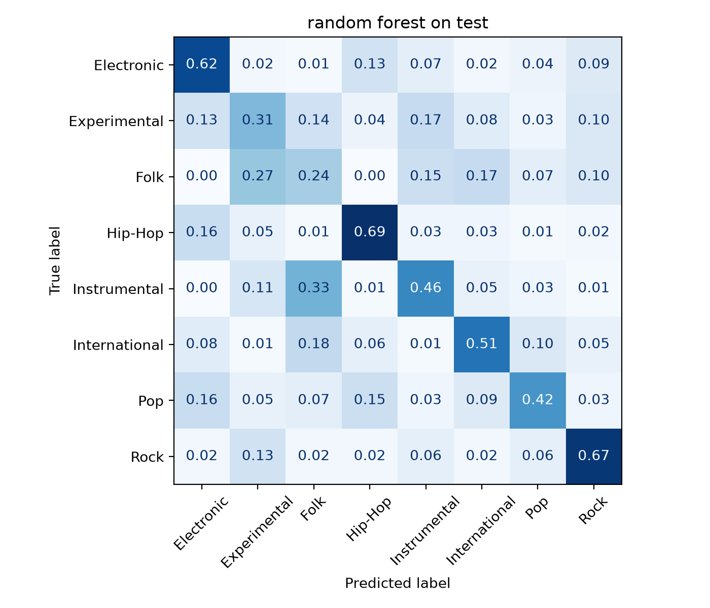
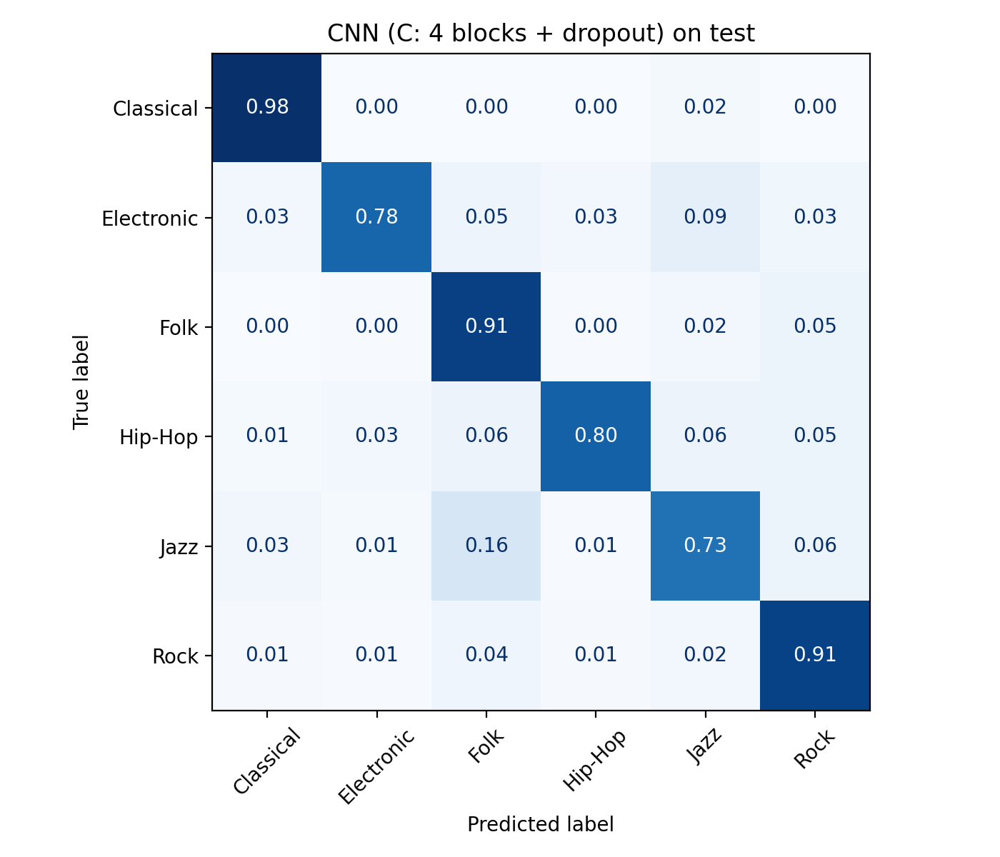

# Music genre classification from audio features and mel-spectrograms

F20DL Data Mining and Machine Learning, UG Group 12

Abdullah Ishraq, Ahmed Khan, Aryadathan Karyadath, Nayela Ehtesham, Luke Nagooroo

## Project

We classify music genre from two representations of tracks in the Free Music Archive (FMA).

- **Pipeline A** uses 518 precomputed audio features per track to predict 8 genres. Models: Gaussian Naive Bayes, logistic regression, decision tree, k-nearest neighbours, random forest and an MLP. We also cluster the tracks with k-means.
- **Pipeline B** uses 128 × 431 mel-spectrograms of 10-second clips to predict 6 genres. Models: logistic regression on per-band summary statistics, and a CNN.

The two datasets cover different genres and tracks. Each pipeline is scored on its own held-out test set, and accuracies are not compared across pipelines.

Research questions:

1. How well do classical models separate the 8 FMA genres, and which genres get confused?
2. Does an MLP beat the best classical model on the same features?
3. Does a CNN on spectrograms beat a linear model on summary statistics of the same spectrograms?

## Milestones

| Week | Milestone                                | Requirement |
| ---- | ---------------------------------------- | ----------- |
| 4    | Project pitch                            | R1          |
| 10   | Data pipeline, FMA EDA and clustering    | R2          |
| 10   | Classical models and MLP                 | R3, R4      |
| 11   | Spectrogram analysis, CNN, final results | R2, R4      |
| 11   | Report and repository submitted          | D2          |
| 12   | Mini-viva                                | D3          |

## Data

|              | FMA Small features                                                                                                                                | Mel-spectrograms                                                                                                                                                                                               |
| ------------ | ------------------------------------------------------------------------------------------------------------------------------------------------- | -------------------------------------------------------------------------------------------------------------------------------------------------------------------------------------------------------------- |
| Source       | Defferrard et al., _FMA: A Dataset for Music Analysis_, ISMIR 2017. [github.com/mdeff/fma](https://github.com/mdeff/fma), file `fma_metadata.zip` | University of Tartu Kaggle competition, [Music Genre Classification from Mel Spectrograms](https://www.kaggle.com/competitions/music-genre-classification-from-mel-spectrograms-dl4cv/data)                    |
| Licence      | CC BY 4.0                                                                                                                                         | CC BY-NC 4.0. The competition rules allow non-commercial research and education use and forbid redistribution                                                                                                  |
| Size         | 8,000 tracks (30 s clips), 1,000 per genre                                                                                                        | 17,382 labelled 10 s clips, 2,897 per genre. The 1,446 unlabelled test clips are not used                                                                                                                      |
| Inputs       | 74 audio descriptors (MFCC, chroma, spectral contrast, tonnetz, centroid, bandwidth, roll-off, RMS energy, zero-crossing rate) × 7 statistics     | One 128 × 431 float32 mel-spectrogram per clip, in decibels from −80 to 0                                                                                                                                      |
| Split        | Official FMA split, 800/100/100 tracks per genre, which keeps each artist in one split                                                            | Stratified 70/15/15 with seed 42 (12,167 / 2,607 / 2,608 clips), stored in `data/splits/spec_splits.csv`                                                                                                       |
| Data quality | No missing or infinite values. 17 duplicate feature rows in 13 groups, none crossing splits; one group carries two different genres               | No missing values in a 300-clip sample. MD5 hashes of all 17,382 arrays find no exact duplicates. Clip IDs are shuffled and don't identify the source song, so clips from one song may sit in different splits |

Models only see audio features. Track IDs and artist or album metadata are excluded because they leak information about the label.

The spectrograms are not stored here, since the competition rules forbid redistribution. `scripts/download_data.py` fetches them from Kaggle.

### Examples

Two FMA training tracks, with 5 of their 518 features:

| track_id | genre   | mfcc_mean_01 | spectral_centroid_mean_01 | zcr_mean_01 | rmse_mean_01 | chroma_stft_mean_01 |
| -------- | ------- | ------------ | ------------------------- | ----------- | ------------ | ------------------- |
| 2        | Hip-Hop | −163.773     | 1639.583                  | 0.086       | 3.189        | 0.696               |
| 140      | Folk    | −225.713     | 1232.634                  | 0.052       | 2.954        | 0.376               |

One training spectrogram per genre (low frequencies at the bottom, time left to right):



## Setup

Python 3.12.

```powershell
py -3.12 -m venv .venv
.venv\Scripts\Activate.ps1      # macOS/Linux: source .venv/bin/activate
pip install -r requirements.txt
```

The spectrogram download needs a Kaggle account:

1. Accept the rules on the [competition page](https://www.kaggle.com/competitions/music-genre-classification-from-mel-spectrograms-dl4cv/rules).
2. Sign in from the terminal with the environment active. This opens a browser window and saves your credentials, so there is no token to copy:

   ```powershell
   kaggle auth login
   kaggle competitions list    # prints a table if you are signed in
   ```

If the browser sign-in doesn't work, generate a token under Kaggle → Settings → API Tokens and save it as `~/.kaggle/access_token` (never commit it):

```powershell
mkdir $HOME\.kaggle -Force
Set-Content -NoNewline $HOME\.kaggle\access_token "KGAT_your_token"
```

The CNN notebook (`06_spec_cnn`) needs a GPU, and native Windows TensorFlow can't use one, so we ran it on Kaggle:

1. Import the notebook on Kaggle, add the competition data as an input, choose GPU T4 x2 and turn Internet on.
2. The repo is private, so store a read-only GitHub token as the Kaggle secret `GITHUB_TOKEN`.
3. Run all cells. The first cell clones the repo, rebuilds the split index from Kaggle's copy of the data and checks that it matches `data/splits/spec_splits.csv`. The last cell zips the figures and results for download.

Locally it runs on Linux or WSL2 with a GPU and about 16 GB of RAM. Everything else runs on a laptop CPU.

## Running the pipeline

```bash
python scripts/download_data.py    # FMA metadata (~342 MB) and Kaggle spectrograms into data/raw/
python scripts/prepare_data.py     # checks the data, builds data/processed/, writes the splits
python -m src.evaluate             # self-test for the metrics code
```

Add `fma` or `spec` to either script to process one dataset.

`prepare_data.py` does the following:

- **FMA:** keeps the 8,000 tracks of the small subset, with their 518 features, genre and official split.
- **Spectrograms:** takes each clip's genre from its folder (`spectrograms_unnormalized/data/<Genre>/`) and creates the stratified split. Clips in `test/` have no labels and are skipped.
- **Checks:** for missing, infinite, duplicate and constant values, plus array shapes and value ranges. Duplicate FMA rows are also checked for crossing splits, which would leak test tracks into training.
- **Reports:** results go to `results/data_check_fma.md` and `results/data_check_spec.md`.

Running it again gives the same splits. Then run the notebooks in order:

| Notebook               | What it does                                                              | Needs             |
| ---------------------- | ------------------------------------------------------------------------- | ----------------- |
| `00_quickstart`        | ZeroR baseline on both datasets                                           | both              |
| `01_fma_eda`           | FMA data quality, scale, redundancy, relevance, PCA                       | FMA               |
| `02_fma_clustering`    | k-means with elbow and silhouette, agreement with genres                  | FMA               |
| `03_fma_baselines`     | NB, logistic regression, decision tree, KNN, random forest (about 10 min) | FMA               |
| `04_fma_mlp`           | Keras MLP, 4 architectures, learning-rate check, overfitting experiment   | FMA               |
| `05_spec_eda_baseline` | Spectrogram EDA, leakage check, logistic regression on summary features   | spectrograms      |
| `06_spec_cnn`          | 3 CNN architectures (Kaggle GPU, about 25 min)                            | spectrograms, GPU |
| `07_results`           | Final tables, hypothesis verdicts, error analysis, notebook run check     | FMA               |

## Repository layout

```
src/            config.py (paths, seed), data.py (loaders), evaluate.py (metrics, plots, result logging)
scripts/        download_data.py, prepare_data.py
notebooks/      one notebook per phase
data/splits/    frozen splits (committed)
data/raw/       downloaded data (not committed)
data/processed/ prepared tables (not committed)
results/        one JSON file per experiment, the data checks, final_tables.md and report_figures.md
figures/        figures used in the report
```

## Results

All scores are on held-out test sets. Full tables are in [`results/final_tables.md`](results/final_tables.md).

### R2: Data analysis

**Inputs:** the FMA training split (6,400 tracks × 518 features) and the spectrogram training clips. **Outputs:** data-quality reports, EDA figures and k-means results. FMA feature scales differ by six orders of magnitude, so every scale-sensitive model is standardised. The genres overlap heavily, and k-means at k = 8 barely recovers them. The spectrograms are balanced, contain no exact duplicates and differ by genre mainly in average spectral shape.

Notebooks: [01 EDA](notebooks/01_fma_eda.ipynb) · [02 clustering](notebooks/02_fma_clustering.ipynb) · [05 spectrogram EDA](notebooks/05_spec_eda_baseline.ipynb)

| Analysis                               | Result               |
| -------------------------------------- | -------------------- |
| PCA components for 90% of FMA variance | 143 of 518           |
| k-means (k = 8) vs genres              | ARI 0.081, NMI 0.133 |
| Exact duplicate spectrograms           | 0 of 17,382          |



### R3: Baseline models

**Inputs:** standardised FMA features, and 256 per-band mean and standard-deviation features per spectrogram. **Outputs:** five classifiers tuned with stratified 5-fold CV on macro-F1 and scored once on test. The random forest is the best FMA model. Folk, Experimental and Pop have the lowest recall, so H1 (Experimental, International, Pop) is partly supported. On the spectrograms, logistic regression on the summary features reaches 0.745 macro-F1.

Notebooks: [03 baselines](notebooks/03_fma_baselines.ipynb) · [05 summary baseline](notebooks/05_spec_eda_baseline.ipynb)

| FMA model           | Macro-F1 | MCC   | Macro-AUC |
| ------------------- | -------- | ----- | --------- |
| Random forest       | 0.487    | 0.417 | 0.828     |
| Logistic regression | 0.449    | 0.373 | 0.813     |
| Decision tree       | 0.360    | 0.272 | 0.740     |
| Gaussian NB         | 0.349    | 0.287 | 0.781     |
| KNN                 | 0.294    | 0.199 | 0.666     |
| ZeroR               | 0.028    | 0.000 | 0.500     |



### R4: Neural networks

**Inputs:** the standardised FMA features (MLP) and per-band standardised spectrograms (CNN). **Outputs:** an MLP compared over 4 architectures plus a learning-rate check, and 3 CNNs trained on a Kaggle T4 GPU, each selected on validation and scored once on test. The MLP does not beat the random forest, which supports H2 (any gain is small). The CNN beats the summary-feature baseline by 0.106 macro-F1, which supports H3.

Notebooks: [04 MLP](/notebooks/04_fma_mlp.ipynb) · [06 CNN](notebooks/06_spec_cnn.ipynb) · [07 final results](notebooks/07_results.ipynb)

| Pipeline         | Model                                 | Macro-F1 | MCC   | Macro-AUC |
| ---------------- | ------------------------------------- | -------- | ----- | --------- |
| A (FMA)          | MLP (256 units, lr 1e-4)              | 0.463    | 0.389 | 0.811     |
| A (FMA)          | Random forest (best classical)        | 0.487    | 0.417 | 0.828     |
| B (spectrograms) | CNN (4 blocks, dropout)               | 0.852    | 0.824 | 0.984     |
| B (spectrograms) | Logistic regression, summary features | 0.745    | 0.697 | 0.940     |


